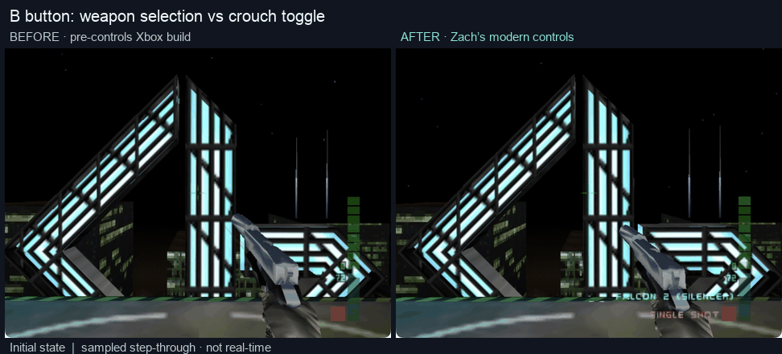
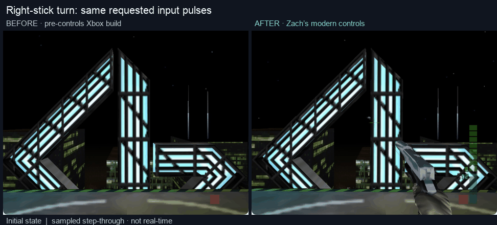
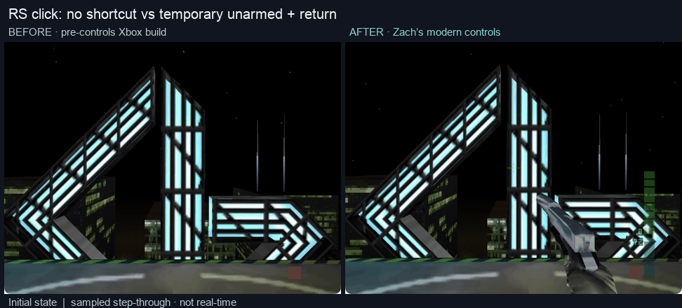

# Fork differences and Perfect Dark upstream alignment

Assessment: 2026-11-18. The fork pursues modern shooter controls on original Xbox.
Changing original behavior can serve that goal without making the original a bug.
SDK work has a separate [nxdk candidate table](nxdk-upstream-candidates.md).

## Comparison scope

| Baseline | Meaning for this document |
| --- | --- |
| Local code | Committed base `86566c096` plus uncommitted controller/combat work documented in [controller-feel.md](controller-feel.md). The recent updates were not included when the GitHub fork was created. |
| Immediate upstream: [Perfect Dark X](https://github.com/GTTeancum/Perfect-Dark-X) | Much of the Xbox backend and packaging is inherited. The fork’s `codex/local-port` preserves the committed base; `port` initially inherited five newer source-repository commits. This is not an exhaustive comparison with those commits. |
| Broader upstream: [Perfect Dark PC port](https://github.com/perfect-dark-pc-port/perfect_dark/blob/port/README.md) | Already supports modern controls, FOV, high frame rates, and selected fixes. This supports optional modernization in principle, not automatic agreement with particular mechanics or defaults. |
| Underlying decompilation | Source-reconstruction reference. New gameplay normally belongs in a port/mod; its contribution policy was not audited here. |

**Priority means suggested upstream review order**, not importance to the fork or
feature completeness. P1 = establish a repair; P2 = propose an optional enhancement;
P3 = explicit gameplay/default-policy discussion. Alignment is our assessment,
not a statement from maintainers. The assessment itself added no build or runtime tests; the visual comparisons below were captured afterward.

## Before-and-after GIFs

Each GIF places the **pre-controls Xbox build on the left** and **Zach’s modern
controls on the right**. These are actual XEMU screenshots from Defection on
Agent with stock textures, presented as sampled steps rather than real-time
video. Both sides receive the same requested pulses for the illustrated action.
They are independent launches, not identical saved states or frame-synchronized runs.

| Priority / category | Before-and-after comparison | What it demonstrates |
| --- | --- | --- |
| **P2 · Button layout** |  | B selects unarmed in the baseline; the fork toggles crouch/stand while retaining the pistol. This is a binding/design change. |
| **P2 · Look response** |  | Five requested 120 ms full-right-stick pulses produce different turning behavior. This illustrates the response change, not precise sensitivity or analog feel. |
| **P3 · Quick melee** |  | The baseline has no RS shortcut; the fork selects unarmed and restores its pistol. Sparse samples miss the strike itself, so this is a selection/restoration comparison, not a damage demonstration. The baseline starts unarmed. |

Before executable: `c612f4fe…` (`default-before-controls.xbe`). After:
`9dfe0e50…` (`default-finals-combat.xbe`). Full hashes, processing details, and
capture limits are in [capture notes](media/fork-differences/capture-notes.json).
Only the window title bar was cropped; both views were resized uniformly.
Playback timing is chosen for reading each step, not measured game timing.

**Zoomed strafing and sprint are not illustrated yet.** The attempted aimed-input
capture was unusable; it is excluded instead of being presented as evidence.
These GIFs do not qualify scoped weapons, enemy damage, sprint speed, or hardware behavior.

## Recent fork updates: prioritized and categorized

| Priority | Category | Update in this fork | Relationship to existing behavior | Upstream alignment / recommended treatment |
| --- | --- | --- | --- | --- |
| **P1 · verify defect** | Input precision | Full-resolution right-stick look bypasses N64-range quantization and repeated conditioning. | Can preserve small inputs, but is currently part of the new look path. | Potential shared correction **if current upstream loses inputs it should preserve**. Reproduce separately; preserve other control schemes and separate precision from tuning. |
| **P1 · with feature** | State correctness | Per-player state and reset gates for pause, death, menus, cameras, and ownership changes. | Makes the added controls safe across gameplay contexts. | Required with any accepted feature. Not an independent upstream bug unless the existing upstream path fails too. |
| **P1 · with feature** | Combat correctness | Ammo conservation, pickup preservation, dual-wield restore, and disarm checks during quick melee. | Prevents the new shortcut from losing items, granting a free reload, or restoring lost weapons. | Ship with quick melee. Do not present as existing upstream defects without an equivalent reproduction. |
| **P2 · optional** | Stick conditioning | 4000-unit radial deadzone replaces the prior 10000-unit axial profile; diagonal magnitude is normalized. | Changes dead area, response, and directional feel. | Useful selectable profile. The threshold and radial preference are tuning decisions, not proof the old profile is broken. |
| **P2 · optional** | Aim response | Quadratic curve, 200/170-degree base rates, 60% ADS gain, and edge-turn boost. | Replaces the inherited feel with modern tuning. | Fork default or optional preset. Upstream may prefer its existing response/defaults. |
| **P2 · optional** | Aim scaling | FOV-aware sensitivity and tick-integrated turn boost. | Adjusts scoped feel and keeps the new boost consistent across tick rates. | Reusable technique within an optional look model. Correctness of the new feature does not prove an old upstream bug. |
| **P2 · optional** | Button layout | Y interact, A weapon cycle, X reload, B full crouch; separate menu accept/cancel. | Changes muscle memory and crouch selection while keeping UI actions separate. | Offer as a preset. Replacing upstream defaults requires agreement. |
| **P3 · design choice** | Aiming and movement | **Strafe and move forward/back while aiming/zoomed**, at 90% full-stick movement, with camera-based look. | Intentionally permits combined movement, look, and fire under the modern profile. | **Upstream may disagree** with altered aiming constraints, speeds, or floating-crosshair semantics. Propose an optional mode; do not label the policy itself a bug fix. |
| **P3 · gameplay** | Sprint | LS toggle, 35% bonus, short ramp, cancellation rules; replaces the delayed native run bonus in this path. | Alters speed, timing, and movement balance. | Fork/mod or explicitly optional feature. Native collision does not make the speed policy unchanged. |
| **P3 · gameplay** | Quick melee | RS performs a native unarmed strike, then restores the previous weapon. | Adds a combat shortcut and changes weapon-switch workflow. | Fork/mod or optional feature. Native animations and damage do not make the new action original behavior. |

Implementation references in the local working tree: `port/src/input.c`,
`src/game/bondmove.c`, `port/include/xbox_controller_feel.h`, and
`port/src/xbox/combat_xbox.c`. The controller/combat source updates remain
uncommitted and are not published by this documentation PR. Preserve the
[controller reference attribution and license](controller-reference-LICENSE.txt)
when extracting contributions.

## Strafing while zoomed: feature versus repair

| Claim | Classification | What would justify an upstream proposal? |
| --- | --- | --- |
| “Players should be able to strafe while zoomed for modern feel.” | Fork design objective | Describe the changed behavior and offer an optional profile. Upstream may deliberately retain its existing rules. |
| “Our modern profile permits movement, but its native movement gates blocked it.” | Implementation repair within the fork | Fix the gates so the chosen feature works. This does not establish an upstream defect. |
| “An existing supported upstream scheme promises this combination, but it fails.” | Possible upstream bug | Reproduce on current upstream without the modern profile, establish expected behavior, and submit the minimal repair. |
| “LT plus movement/look/fire passed on Xbox.” | Bounded functional evidence | The [controller notes](controller-feel.md) record the checks. They do not qualify every variable-zoom scope, special weapon, multiplayer context, or subjective stick feel. |

## Inherited Xbox work and broader portability candidates

These describe the Xbox lineage relative to the PC port. They are **not claims
of changes unique to Zach**; check history before attributing or proposing them.

| Priority | Category | Area | Upstream alignment / next step |
| --- | --- | --- | --- |
| **P1 · verify defect** | Data loading | Complete inflate loops and detect incomplete output. | Possible shared loader correction. Compare current PC-port code, reproduce partial progress, and verify bounds. |
| **P1 · platform repair** | Presentation | Correct swap-interval reporting and skip empty render completions. | Fits the Xbox backend. For a project without that backend, this accompanies a platform addition rather than repairing an existing regression. |
| **P2 · platform feature** | Video compatibility | Dashboard 480i/480p/720p, PAL handling, raster verification, safe fallback. | Natural Xbox support. PC upstream acceptance also means maintaining the platform. |
| **P2 · platform feature** | Rendering and audio | Native NV2A renderer and AC97 output. | Substantial backend features; assess maintenance and interface fit separately from mechanics. |
| **P2 · optional architecture** | Assets and packaging | ROM-free loose loading and installer. | Useful memory-saving architecture; generalization needs optional integration and validation, not a bug-fix label. |
| **P2 · platform feature** | Controllers and tooling | Joining, disconnect notices, serial diagnostics, XEMU harness. | Useful support features/tools. Extract demonstrated shared defects separately. |
| **P3 · platform policy** | Resource budgets | Heap and texture budgets, effect reductions, 720p frame cap. | Keep Xbox-specific tradeoffs per platform; avoid imposing them on desktop. |
| **Local integration** | Dependencies | Allocators required by `Z_SOLO` zlib. | Required freestanding integration; not a zlib defect by itself. |

## Contribution framing

| Proposal type | Include | Keep separate |
| --- | --- | --- |
| Bug fix | Existing upstream contract, reproducer, minimal change, before/after evidence | New profile preferences or unrelated mechanics |
| Optional modern controls | Behavioral differences, configuration/defaults, compatibility path, tests | Claims that a preferred feel is the only correct behavior |
| Gameplay addition | Speed/balance effects, native-system interactions, cancellation and restore behavior | Platform compatibility repairs |
| Xbox platform support | Backend interfaces, build/runtime evidence, maintenance scope | Replacing established gameplay defaults |
